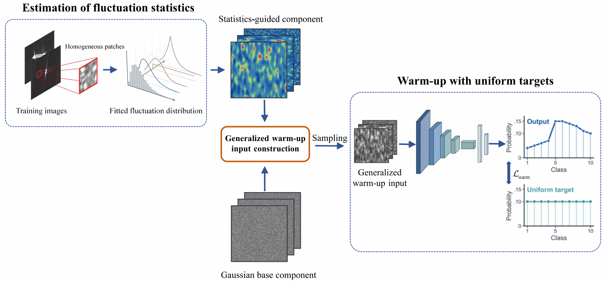

# Generalized Warm-up

**Generalized warm-up for confidence calibration of deep neural network classifiers**

[](#video-overview)
[](https://huggingface.co/kanadelsy/generalized-warmup-assets)
[](docs/DOWNLOADS.md#results)
[](docs/EXPERIMENTS.md)
[](docs/ENVIRONMENTS.md)
[](LICENSE)

Shuai-Yu Li · Xin-Chao Wang · Yu-Ying Song · Si-Wei Chen

## Overview

Generalized warm-up prepares a classifier with uniform targets before supervised
learning. Its inputs combine a Gaussian base with a statistics-guided component
constructed from approximately homogeneous regions of training images.



## Video overview

https://github.com/user-attachments/assets/55e696a0-4615-41a3-863f-42b5f4a8aafa

## Quick start

```sh
git clone https://github.com/LeeShuaiyu/generalized-warmup-release.git
cd generalized-warmup-release
python3.12 -m venv .venv
source .venv/bin/activate
python -m pip install -e '.[notebook]'
python scripts/prepare_results.py
python -m jupyterlab notebooks/
```

Windows (Command Prompt): `py -3.12 -m venv .venv`, then `.venv\Scripts\activate`.

Recompute tables on a CPU from released predictions and source measurements.
Notebooks: [Random initialization](notebooks/main_random.ipynb) ·
[ImageNet initialization](notebooks/main_pretrained.ipynb) ·
[Paper figures](notebooks/paper_figures.ipynb).

[All experiments](docs/EXPERIMENTS.md) · [Environments](docs/ENVIRONMENTS.md)

## Results and models

[Hugging Face](https://huggingface.co/kanadelsy/generalized-warmup-assets):
results and **388 checkpoints in 50 archives**.

```sh
python scripts/plan_downloads.py --experiment s4_family
python scripts/prepare_assets.py --experiment s4_family \
  --package-index artifacts/model_packages.json --url-index artifacts/model_urls.json
```

[Inference and training](docs/USAGE.md) · [Data preparation](data/README.md) ·
[Downloads](docs/DOWNLOADS.md)

## Citation

```bibtex
@software{li2026generalizedwarmup,
  author = {Li, Shuai-Yu and Wang, Xin-Chao and Song, Yu-Ying and Chen, Si-Wei},
  title = {Generalized warm-up for confidence calibration of deep neural network classifiers},
  year = {2026},
  url = {https://github.com/LeeShuaiyu/generalized-warmup-release}
}
```

## License

Original code and documentation: [MIT](LICENSE). Contributor-owned weights:
[MIT](LICENSE-MODELS). Original numerical results: [CC BY 4.0](LICENSE-RESULTS).

[Scope and attribution](LICENSES.md) · [Third-party terms](docs/THIRD_PARTY.md)
